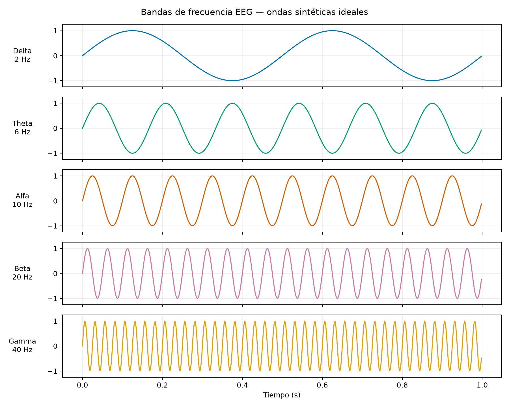
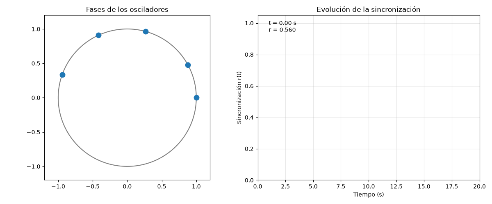

# Frequency modeling in different cognitive states

### Paola Castillo Camacho

### Affiliations

- Autonomous University of Mexico (UNAM)

- National School of Higher Studies (ENES)

## Description

This project aims to use the Kuramoto model to simulate the behavior of different brainwave frequencies and analyze their levels of phase synchronization under different mental and cognitive states.

The main objective is to investigate how natural frequencies and coupling strength influence synchronization between oscillators.

## Kuramoto Model (phase synchronization):

The Kuramoto model is a mathematical model, expressed as a system of coupled ordinary differential equations (ODEs), that describes how a group of oscillators (like brain waves) synchronize over time. Each oscillator has its own natural frequency, and the coupling between them pulls their phases together.

In this project, it is going to be used to represent how meditation can increase coherence between different brain regions. Since the system has no simple closed-form solution, it will be solved numerically using the fourth-order Runge-Kutta method (RK4).

**Governing equation**

$$
\frac{d\theta_i}{dt} = \omega_i + \frac{K}{N}\sum_{j=1}^{N}\sin(\theta_j - \theta_i), \quad i = 1,\dots,N
$$

- $\theta_i(t)$: phase of oscillator $i$ (radians)
- $\omega_i$: natural frequency of oscillator $i$, usually drawn from a distribution $g(\omega)$ (e.g., Gaussian)
- $K$: coupling strength between oscillators
- $N$: number of oscillators
- $\sin(\theta_j - \theta_i)$: pulls oscillator  $i$  toward the phase of oscillator  $j$

**Order parameter (measure of synchrony)**

$$
r(t)\,e^{i\psi(t)} = \frac{1}{N}\sum_{j=1}^{N} e^{i\theta_j(t)}
$$

- $r \in [0,1]$:  $r \approx 0$ means incoherent (desynchronized),  $r \approx 1$ means fully synchronized
- $\psi$: average phase of the population

**Mean-field form** 

$$
\frac{d\theta_i}{dt} = \omega_i + K\,r\,\sin(\psi - \theta_i)
$$

**Critical coupling** (for a symmetric, unimodal $g(\omega)$ ): synchronization emerges when

$$
K > K_c = \frac{2}{\pi\, g(0)}
$$

---
## Brain Waves and EEG

For this project, understanding brain waves and their frequency bands is essential for defining the natural frequencies of the oscillators in the Kuramoto model.

Electroencephalography (EEG) records differences in electrical potential on the scalp, which reflect the combined activity of large populations of neurons. EEG signals are commonly divided into frequency bands, whose boundaries are approximate and may vary across studies.

| Band  | Approximate Frequency | Common Associations |
|---|---|---|
| Delta | 0.5–4 Hz | Deep sleep |
| Theta | 4–8 Hz | Drowsiness, memory, and certain meditative practices |
| Alpha | 8–13 Hz | Relaxed wakefulness |
| Beta | 13–30 Hz | Cognitive and motor activity |
| Gamma | 30–80 Hz | Sensory and cognitive processing |

These frequency bands serve as a reference for defining the different scenarios simulated in this project.

Here is a graph made with Python of what brain waves would hypothetically look like.

## Frequency Selection

Initially, this project aimed to use real electroencephalography (EEG) data. However, the limited availability of open-access datasets and the lack of suitable recordings for the scenarios of interest made this approach difficult to implement.

Therefore, general brainwave frequency ranges associated with different mental and cognitive states were selected to simulate and analyze synchronization using the Kuramoto model.

| Scenario | Frequency Band | Proposed Range |
|---|---|---|
| Transcendental Meditation | Alpha | 8–12 Hz |
| Stress | High Beta | 23–30 Hz |
| Anxiety | Beta | 13–30 Hz |
| Cognitive Effort | Frontal Theta | 4–7 Hz |

The objective is to analyze how natural frequencies and coupling strength affect synchronization between oscillators.

It is important to emphasize that these frequency ranges represent a simplified approximation of brain activity. Therefore, the results are theoretical and exploratory rather than a direct representation of actual brain dynamics.

## Visualization of the Kuramoto model

## References

### Kuramoto Model

- Acebrón, J. A., Bonilla, L. L., Pérez Vicente, C. J.,
  Ritort, F., & Spigler, R. (2005).
  The Kuramoto model: A simple paradigm for synchronization
  phenomena. Reviews of Modern Physics, 77, 137–185.
  https://doi.org/10.1103/RevModPhys.77.137

### EEG and Brain Waves

- Newson, J. J., & Thiagarajan, T. C. (2019).
  EEG Frequency Bands in Psychiatric Disorders:
  A Review of Resting State Studies.
  Frontiers in Human Neuroscience, 12, 521.
  https://doi.org/10.3389/fnhum.2018.00521

- Lachaux, J. P., Rodriguez, E., Martinerie, J.,
  & Varela, F. J. (1999).
  Measuring phase synchrony in brain signals.
  Human Brain Mapping, 8(4), 194–208.
  https://pubmed.ncbi.nlm.nih.gov/10619414/

### Mental and Cognitive States

- Travis, F., & Shear, J. (2010).
  Focused attention, open monitoring and automatic
  self-transcending: Categories to organize meditations
  from Vedic, Buddhist and Chinese traditions.
  Consciousness and Cognition, 19(4), 1110–1118.
  https://doi.org/10.1016/j.concog.2010.01.007

- Vanhollebeke, G., et al. (2022).
  The neural correlates of psychosocial stress:
  A systematic review and meta-analysis of spectral
  analysis EEG studies.
  https://pubmed.ncbi.nlm.nih.gov/35573807/

- Cavanagh, J. F., & Frank, M. J. (2014).
  Frontal theta as a mechanism for cognitive control.
  Trends in Cognitive Sciences, 18(8), 414–421.
  https://doi.org/10.1016/j.tics.2014.04.012

### Numerical Methods

- Hairer, E., Nørsett, S. P., & Wanner, G. (1993).
  Solving Ordinary Differential Equations I:
  Nonstiff Problems. Springer.
  https://doi.org/10.1007/978-3-540-78862-1
